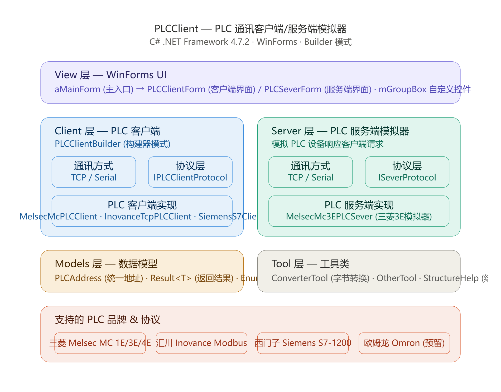

# PLCClient

个人开发的一款 PLC 客户端以及服务端测试工具。旨在将工作中常用的 PLC 全部实现模拟通讯。缓慢开发中……

| 项目 | 说明 |
| --- | --- |
| 工程文件 | `PlcTest.csproj`（老式非 SDK 工程，程序集清单手工维护） |
| 程序集 / 根命名空间 | `PlcTest` |
| 运行环境 | .NET Framework 4.7.2 · WinForms（`OutputType=WinExe`） |
| 第三方依赖 | 无，只用 BCL |
| 解决方案 | `PlcTest.slnx` |

## 软件架构



整体分三层：**模型层（`Models`）→ 通讯层（`Client` / `Server`）→ 界面层（`View`）**，依赖单向，`Models` 为叶节点。

通讯层把「怎么发数据」和「数据怎么编解码」拆成两条互不依赖的抽象，任一侧换实现都不影响另一侧：

| 层次 | 接口 | 现有实现 | 职责 |
| --- | --- | --- | --- |
| 客户端 · 通讯方式 | `IClientCommunication` | `TcpClientCommunication`、`SerialPortClientCommunication` | 建连、收发原始字节（内部串行化并读全帧） |
| 客户端 · 通讯协议 | `IPlcClientProtocol` | `ClientProtocolManagement\` 下各厂商协议 | 组装请求报文、解析响应报文 |
| 客户端 · 设备 | `IPlcClient` | `CommunicationPlcClient`（单一实现，构造注入通讯、协议与位/字规则） | 连接、心跳与 8 个读写 |
| 服务端 · 通讯方式 | `IServerCommunication` | `TcpServerCommunication`、`SerialServerCommunication` | 监听端口、收发字节，每个连接用 `IClientSession` 标识 |
| 服务端 · 通讯协议 | `IServerProtocol` | `ServerProtocolManagement\Melsec\` 下 6 个协议（1E/3E/4E × Binary/ASCII） | 解析请求、构建响应报文（含结束码与写数据解码） |
| 服务端 · 设备 | `IPlcServer` | `MelsecPlcServer`（通用实现）+ `MelsecMc3EPlcServer`（薄子类） | 回应客户端的读写请求 |
| 服务端 · 寄存器表 | `IRegisterTable` | `MelsecPlcServer` | 模拟寄存器的增删查改与清零 |

贯穿全项目的几套惯用写法：

- **接口抽象**：上表每一行两端都靠接口隔离，厂商代码只碰接口不碰具体类。
- **建造者**：`PlcClientBuilder` / `PlcServerBuilder` 流式拼装「通讯方式 + 协议 + 实例」，一行链式调用出实例。
- **组合收敛**：`CommunicationPlcClient` 用同一个类承担连接、断开、心跳重连与 8 个读写的「拼包 → 发送 → 解析」骨架；通讯对象、协议实现、位/字地址规则（如三菱「D 为字、其余为位」）全部由构造函数注入，不再为每个厂商派生空子类，异常统一收敛成失败 `Result`。
- **模板方法**：`TemplateClientProtocol` / `TemplatePlcClient` 是留白的骨架，新增厂商时复制这两个文件往里填就行。
- **依赖注入**：客户端与服务端的构造函数都接收通讯接口与协议接口，传 `null` 时内部 `new` 默认实现，方便替换和测试。
- **心跳保活**：`Connect()` 之后起后台心跳线程，1 s 一轮，断线自动重连（`CommunicationPlcClient.HeartBeatLoop`）。

### 核心功能

- 实现 PLC 客户端通讯
- 实现 PLC 服务端模拟

## 统一地址模型

各厂商共用 `Models\PlcAddress.cs`，屏蔽「三菱的 D100」「西门子的 DB1.DBW0」这类差异：

```csharp
// 字地址：D100，长度 1
PlcAddress.Word(MemoryArea.D, 100);

// 位地址：M10
PlcAddress.Bit(MemoryArea.M, 10);

// 西门子 DB 块，10 个字
PlcAddress.Word(MemoryArea.D, 0, dbNumber: 1, length: 10);
```

- `PlcAddress` 只携带 `Area` / `Address` / `Length` / `IsBit` / `DbNumber` 五个字段，位与字的区别由 `IsBit` 表达。
- `MemoryArea` 覆盖三菱软元件：`SM` `SD` `X` `Y` `M` `L` `F` `V` `B` `D` `W` `TS` `TC` `TN` `SS` `SC` `SN` `CS` `CC` `CN` `SB` `SW` `S` `DX` `DY` `Z` `R` `ZR`。
- 读写统一返回 `Result<T>`（`IsSuccess` / `Data` / `ErrorMsg`），失败不抛异常。

## 协议支持进度

客户端全部通过 `PlcClientBuilder` 选择协议：

| 厂商 | 协议 | 建造者方法 | 协议实现 | 客户端封装 | 服务端模拟 |
| --- | --- | --- | --- | --- | --- |
| 三菱 | MC 1E ASCII | `UseMelsecMc1EAscii()` | ✅ | ✅ | ✅ |
| 三菱 | MC 1E Binary | `UseMelsecMc1EBinary()` | ✅ | ✅ | ✅ |
| 三菱 | MC 3E ASCII | `UseMelsecMc3EAscii()` | ✅ | ✅ | ✅ |
| 三菱 | MC 3E Binary | `UseMelsecMc3EBinary()` | ✅ | ✅ | ✅ |
| 三菱 | MC 4E ASCII | `UseMelsecMc4EAscii()` | ✅ | ✅ | ✅ |
| 三菱 | MC 4E Binary | `UseMelsecMc4EBinary()` | ✅ | ✅ | ✅ |
| 西门子 | S7-1200（S7comm） | `UseSiemensS71200()` | ✅ | ✅ | — |
| 欧姆龙 | FINS TCP | `UseOmronFinsTcp()` | ❌ 未实现 | ❌ 读写未实现 | — |
| 汇川 | Modbus TCP | `UseInovanceModbusTcp()` | ✅ | ✅ | — |
| 汇川 | Modbus RTU | `UseInovanceModbusRtu()` | ✅ | ✅ | — |

> 表中「协议实现 ✅」指报文编解码已写完。
>
> 未实现的入口不会在运行时才炸：`UseOmronFinsTcp()`、`BuildOmronPlcClient()` 直接抛 `NotSupportedException`；三菱 4E ASCII 与西门子 S7 已接入客户端封装，可正常构建使用。

服务端已覆盖三菱 MC 六种协议：**1E / 3E / 4E × ASCII / Binary**。六者共用 `MelsecPlcServer`（`0x0401` 批量读、`0x1401` 批量写、按软元件代码维护位 / 字两张模拟寄存器表），帧格式差异全部由注入的 `IServerProtocol` 承担；`MelsecMc3EPlcServer` 只是绑定默认协议的薄子类。服务端只模拟 `D`（字）与 `M`/`X`/`Y`（位）四类区域。

## 快速开始

环境：Visual Studio 2019 及以上，或装有 .NET Framework 4.7.2 Developer Pack 的 MSBuild。

```powershell
# 用 Visual Studio 打开
start PlcTest.slnx

# 或者命令行重建
MSBuild PlcTest.csproj /t:Rebuild /p:Configuration=Debug
```

作为客户端库使用的最小例子：

```csharp
using PlcTest.Models;                          // PlcClientBuilder / PlcAddress / MemoryArea
using PlcTest.Client.ClientInterface;          // IPlcClient

var client = new PlcClientBuilder()
    .UseTcp("192.168.1.10", 5000)
    .UseMelsecMc3EBinary()
    .BuildMelsecMcPlcClient();

client.ShowCommMessageEvent += msg => Console.WriteLine(msg);   // 交互报文日志
client.Connect();

Result<short[]> read = client.ReadWordArray(PlcAddress.Word(MemoryArea.D, 100, null, 10));
if (read.IsSuccess)
{
    foreach (short v in read.Data)
    {
        Console.WriteLine(v);
    }
}
else
{
    Console.WriteLine("读取失败：" + read.ErrorMsg);
}

client.WriteWord(PlcAddress.Word(MemoryArea.D, 100), 1234);
client.WriteBit(PlcAddress.Bit(MemoryArea.M, 10), true);

client.Disconnect();
```

串口通讯把 `UseTcp(...)` 换成 `UseSerial("COM3", 9600, Parity.None, 8, StopBits.One)` 即可，协议那一行不动。

服务端用对称的 `PlcServerBuilder` 起步：

```csharp
using PlcTest.Server;
using PlcTest.Server.ServerInterface;

IPlcServer server = new PlcServerBuilder()
    .UseTcp("127.0.0.1", 5000)
    .UseMelsecMc3E()
    .Build();
server.OpenServer();   // 之后客户端即可按 MC 3E Binary 连入并读写模拟寄存器
```

## 界面

| 窗体 | 功能 |
| --- | --- |
| `MainForm` | 客户端 / 服务端连接参数配置、连接状态指示灯、打开寄存器视图；连接客户端与开启服务端时都会弹出「通讯方式 + 协议」选择框 |
| `ConnectSettingsForm` | 连接设置对话框：选 TCP / 串口与协议；串口模式下 IP 框填串口名（如 COM3）、端口框填波特率。客户端模式列出全部客户端协议，服务端模式只列三菱六种协议 |
| `PlcClientForm` | 选区域 + 起始地址 + 长度后周期读取（1 s），表格展示：D 区展开 16 个位并附高字节 / 低字节 / short / ASCII，其他区按点位显示；双击位格反写回 PLC；单点写位 / 写字；区间清零与全区清零；通讯报文日志框 |
| `PlcServerForm` | 初始化服务端模拟寄存器的区域与范围、单点改写模拟值、清零 |

界面文案目前是英文（`Please Check ...`），控件命名沿用 `btn_` / `tb_` / `lab_` / `cmb_` / `DGV` 前缀，Designer 生成的代码不动。

## 目录结构

```
PLCClient/
├─ Models/                         统一模型
│  ├─ PlcAddress.cs                统一 PLC 地址模型
│  ├─ Result.cs                    统一返回结果
│  ├─ RequestInfo.cs               服务端解析出的请求结构（含强类型 DeviceArea）
│  └─ Enums.cs                     MemoryArea / PlcType / CommunicationType
├─ Client/
│  ├─ ClientInterface/             IClientCommunication / IPlcClient / IPlcClientProtocol
│  ├─ ClientCommunication/         TCP、串口通讯实现（内部串行化 + 读全帧）
│  ├─ ClientProtocolManagement/    各厂商协议实现
│  │  ├─ Melsec/                   1E/3E/4E × ASCII/Binary
│  │  ├─ Siemens/                  S7-1200
│  │  ├─ Omron/                    FINS TCP
│  │  ├─ Inovance/                 Modbus RTU / TCP
│  │  └─ Template/                 新协议模板
│  ├─ PlcClient/                   CommunicationPlcClient（组合式客户端）+ Omron/Template 骨架
│  └─ PlcClientBuilder.cs          客户端建造者
├─ Server/
│  ├─ ServerInterface/             IPlcServer / IRegisterTable / IServerCommunication / IServerProtocol / IClientSession
│  ├─ ServerCommunication/         TCP 监听、串口
│  ├─ ServerProtocolManagement/Melsec/   1E/3E/4E × ASCII/Binary 协议解析与响应构建
│  ├─ PlcServer/Melsec/            MelsecPlcServer 通用模拟服务 + MelsecMc3EPlcServer 薄子类
│  └─ PlcServerBuilder.cs          服务端建造者
├─ View/
│  ├─ Forms/                       MainForm / PlcClientForm / PlcServerForm / ConnectSettingsForm（命名空间 PlcTest.View.Forms）
│  └─ CustomControl/               MGroupBox 自绘分组框
├─ Tool/                           ConverterTool（位 / 字节 / ASCII 转换）、OtherTool（校验）、StructureHelp
├─ Document/                       协议报文与架构资料
└─ Program.cs                      程序入口
```

## 文档资料

- `Document/md/项目架构总览.png`：架构图
- `Document/Melsec/`：3E / 4E 报文、寄存器地址、控制命令截图
- `Document/Siemens/`：两次握手、读写报文、区域类型、功能编码、ROSCTR、PUD 类型截图
- `Document/Inovance/Modbus.doc`：Modbus 协议资料

## 待办

- [ ] 欧姆龙 FINS TCP：补齐协议编解码与客户端 8 个读写
- [ ] 西门子 S7：DB 区读写与 M0.3 这类位偏移（`PlcAddress` 目前没有位序号字段）
- [ ] 服务端补齐其他厂商（西门子、欧姆龙、汇川）
- [ ] `btn_Trigger` 触发按钮还没有事件实现
- [ ] 界面提示语英文化 → 改中文
- [ ] 用真实 PLC / 客户端做一次真机联调（本轮结构改造只做了编译验证）
