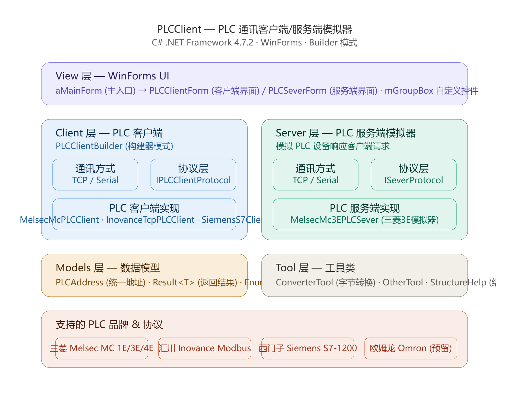

# PLCClient

个人开发的一款 PLC 客户端以及服务端测试工具。旨在将工作中常用的 PLC 全部实现模拟通讯。缓慢开发中……

| 项目 | 说明 |
| --- | --- |
| 工程文件 | `PlcTest.csproj`（老式非 SDK 工程，程序集清单手工维护） |
| 程序集 / 根命名空间 | `PlcTest` |
| 运行环境 | .NET Framework 4.7.2 · WinForms（`OutputType=WinExe`） |
| 第三方依赖 | 无，只用 BCL |
| 解决方案 | `PlcTest.slnx` |

## 软件架构



整体分四层：**`Models`（模型）→ `Protocols` / `Tool`（协议知识与工具）→ `Client` / `Server`（通讯层）→ `View`（界面）**，依赖严格单向，`Models` 为叶节点。

- `Models` 只 `using System.*`；`Protocols`、`Tool` 只向下依赖 `Models`
- `Client` 与 `Server` **互不依赖**（服务端模拟软元件时查的是 `Protocols` 里的软元件表，不再反向引用客户端）
- 只有 `View` 同时依赖 `Client` / `Server`

通讯层把「怎么发数据」和「数据怎么编解码」拆成两条互不依赖的抽象，任一侧换实现都不影响另一侧：

| 层次 | 接口 | 现有实现 | 职责 |
| --- | --- | --- | --- |
| 客户端 · 通讯方式 | `IClientCommunication` | `TcpClientCommunication`、`SerialPortClientCommunication` | 建连、收发原始字节（收发串行化；按协议给出的帧长读满一帧） |
| 客户端 · 通讯协议 | `IPlcClientProtocol` | `ClientProtocolManagement\` 下各厂商协议 | 组装请求报文、解析响应报文、声明区域访问能力与应答帧长 |
| 客户端 · 设备 | `IPlcClient` | `CommunicationPlcClient`（单一实现，构造注入通讯、协议与位/字规则） | 连接、心跳与 8 个读写 |
| 服务端 · 通讯方式 | `IServerCommunication` | `TcpServerCommunication`、`SerialServerCommunication` | 监听端口、收发字节，每个连接用 `IClientSession` 标识 |
| 服务端 · 通讯协议 | `IServerProtocol` / `IModbusServerProtocol` / `IOmronFinsServerProtocol` | 三菱 6 个（1E/3E/4E × Binary/ASCII）+ 汇川 2 个（Modbus TCP/RTU 从站）+ 欧姆龙 FINS | **帧定界**、解析请求、构建响应（含结束码 / 异常码与写数据解码）、声明本协议支持的软元件区域 |
| 服务端 · 设备 | `IPlcServer` + `PlcServerBase` | `MelsecPlcServer`、`InovancePlcServer`、`OmronFinsServer` | 回应客户端的读写请求。**启停、客户端计数、通讯日志、收帧异常兜底都在 `PlcServerBase`**，三家只实现 `HandleFrame`（怎么应答）与寄存器存储 |
| 共享 · 软元件表 | — | `Protocols/` 下 4 份 catalog（三菱 3E4E / 三菱 1E / 汇川 / 欧姆龙）+ `DeviceAreaInfoProvider` | 软元件代码、编号范围、位/字能力、名称与 Modbus/FINS 编址的**唯一真相**，Client 与 Server 都向下查 |
| 服务端 · 寄存器表 | `IRegisterTable` | `MelsecPlcServer`、`InovancePlcServer`、`OmronFinsServer` | 模拟寄存器的增删查改与清零 |

贯穿全项目的几套惯用写法：

- **接口抽象**：上表每一行两端都靠接口隔离，厂商代码只碰接口不碰具体类。
- **建造者**：`PlcClientBuilder` / `PlcServerBuilder` 流式拼装「通讯方式 + 协议 + 实例」，一行链式调用出实例。
- **组合收敛**：`CommunicationPlcClient` 用同一个类承担连接、断开、心跳重连与 8 个读写的「拼包 → 发送 → 解析」骨架；通讯对象与协议实现由构造函数注入，不再为每个厂商派生空子类，异常统一收敛成失败 `Result`。
- **欧姆龙 FINS 是两层套娃**：`OmronFinsTcpClientProtocol` 负责外层 FINS/TCP 外壳（16 字节 `FINS` + 长度 + 命令 2 + 错误码）与内层 FINS 帧（10 字节头 + 指令代码 + 结束代码）。**建连后必须先做节点地址握手**（20 字节请求 → 24 字节响应，取 `[19]`/`[23]` 作为 SA1/DA1）；`OmronPlcClient` 因此不重复实现 8 个读写，而是继承 `CommunicationPlcClient`、只重写 `Connect()` 插入握手，否则 PLC 会静默丢弃后续命令，表现为"连上了但读不到数据"。区码/编号范围集中在 `OmronFinsDeviceCatalog`，位码与字码分开（如 DM 位 `02` / 字 `82`）。
- **位/字只有一处真相**：能不能按位/按字访问由协议声明（`IPlcClientProtocol.GetAreaAccess`），客户端按方法语义（`ReadBit`/`ReadWord`）归一化地址标志，不再维护「D 为字、其余为位」这类客户端侧规则。
- **界面跟着协议走**：`IPlcClient.GetSupportedAreas()`（客户端）/ `IPlcServer.GetSupportedAreas()`（服务端）返回当前协议真正支持的软元件区域，两个窗体都用它填充三个下拉框（读区 / 写位 / 写字），**PLC 上不存在的软元件不会出现在选项里**；
  写位框只列支持位的区域、写字框只列支持字的区域，读区不限。位/字视图的分支也改成按区域能力判断，不再硬编码「是不是 D」。
  断开连接时会关闭绑定了旧协议的窗体，重连后列表不会残留。
- **服务端下拉框曾经把 `MemoryArea` 全部 32 个枚举名直接塞进去**（`Enum.GetNames`），于是三菱服务端也会列出欧姆龙专用的 `CIO` / `HR` / `AR` / `EM`，选中后只是造出一片协议永不应答的模拟地址；
  写位 / 写字两个框同样列全，导致「选中 R 写字却没反应」这类静默失败（旧代码里还有 `if (WriteArea != MemoryArea.D) return;` 的硬编码）。
  现在三处都从 `GetSupportedAreas()` + 区域能力生成，视图形态也按 `SupportsBit` 判定（只有 `SupportsBit` 为 true 才用位视图，与客户端默认一致）。
- **S7 的两段握手单独成一个接口**：`IS7SessionProtocol`（COTP 连接 `0xE0` + Setup Communication `0xF0`，顺便带回协商的 PDU 长度），
  与 `IOmronFinsClientProtocol` 同一套路子——`Build()` 只看协议实现了哪个接口来挑客户端（`S7PlcClient` / `OmronPlcClient` / 通用实现），
  不按厂商枚举配对。握手帧的字节基准来自公开报文样本，写在冒烟测试里逐字节比对；西门子没有服务端，端到端往返测不了，只能靠外部样本卡结构。
- **两个 Builder 结构完全同构，协议分派只有一个入口**：`UseProtocol(ProtocolType)` + 无参 `Build()`。
  两端都是「两个字段（通讯方式 + 已选协议）+ 一行赋值的 `UseXxx` + `Build` 里按**接口**分派」：
  | | 字段 | `Build()` 的分派 |
  | --- | --- | --- |
  | `PlcClientBuilder` | `IClientCommunication` + `IPlcClientProtocol` | 实现 `IOmronFinsClientProtocol` → `OmronPlcClient`（带握手），其余 → `CommunicationPlcClient` |
  | `PlcServerBuilder` | `IServerCommunication` + `object`（三族协议互不继承，见下） | `IOmronFinsServerProtocol` → `OmronFinsServer`；`IModbusServerProtocol` → `InovancePlcServer`（带机型）；`IServerProtocol` → `MelsecPlcServer` |
  
  判断依据是**接口/能力**，不是厂商枚举：新增一个需要特殊客户端的厂商，只要它的协议实现对应接口即可。
  之前 MainForm 里有两个 switch（客户端 10 个 case、服务端 9 个 case），加协议要同时改枚举、两个 Builder、Provider 和窗体；
  现在窗体只传一个枚举，新增协议改到 3 处（枚举 + Builder 的 case + 软元件表）。
  服务端的协议字段之所以是 `object`：`IServerProtocol` / `IModbusServerProtocol` / `IOmronFinsServerProtocol` 三族互不继承（响应结构本质不同），
  硬塞进一个基接口只会到处判空——与客户端「一个 `IPlcClientProtocol` 通吃」的情况不同，这里用 `is` 分派是刻意的。
- **软元件视图（DeviceView）**：两个窗体的第三个页签，列出「区域 / 描述 / 位 / 字 / 备注」。描述与位/字能力不在界面里硬编码，统一走 `DeviceAreaInfoProvider`：
  | 协议 | 描述来源 |
  | --- | --- |
  | 三菱 3E/4E | `Protocols/Melsec3E4EDeviceCatalog`（28 种，如 M=内部继电器） |
  | 三菱 1E | `Protocols/Melsec1EDeviceCatalog`（12 种，如 M=辅助继电器，叫法与 3E 不同） |
  | 汇川 Modbus | `Protocols/InovanceDeviceCatalog`（按服务端/客户端的机型取；Easy 独有的 B 区在 `Get` 里兜底取名） |
  | 欧姆龙 FINS | `Protocols/OmronFinsDeviceCatalog` |
  | 西门子 S7 | 没有 catalog，只有 X/Y/M 三项，直接写死 |
  **两端行集合都问自己**：客户端 `IPlcClient.GetSupportedAreas()`、服务端 `IPlcServer.GetSupportedAreas()`（三菱由 `IServerProtocol` 转发到对应软元件表，汇川按机型、欧姆龙查 FINS 表）。换机型会自动变少，如汇川 Easy 只有 7 项。**备注列暂时留空**，字段已就位，后续要写编号范围/机型差异直接填。
- **读视图按能力 + 用户选择**：`IsBitArea()` 决定一行是「一个点位」还是「16 点」。仅支持位的区域（三菱 TS/TC/CS/CC、汇川线圈区）恒为位视图；仅支持字的区域（D、汇川寄存器区）恒为字视图；**位字皆可**的区域（三菱 M / X / Y / SM / S、欧姆龙 D / CIO / W / HR / AR / EM、西门子 M / X / Y）默认为**位视图（一行一个点位）**，勾选组内的「按字读取（16 点/行）」后切到字视图。位视图的 0/1 显示在 `All` 列，双击该列即翻转该点；字视图双击 16 位列之一翻转对应位。
- **三菱软元件表集中**：`Melsec3E4EDeviceCatalog` 是 **QnA 兼容 3E / 4E 帧共用**的软元件表（两者只有帧头不同，软元件代码与编号规则一致），是三菱软元件代码、位/字能力、**编号进制**与默认编号范围的唯一来源（依据《基本型 QCPU 软元件一览》）。3E / 4E × ASCII / Binary 四个协议全部改为查表，不再各写一份 28 个 `case` 的 switch；ASCII 地址按「X/Y/B/W/SB/SW/DX/DY/ZR 十六进制，其余十进制」格式化。
- **1E 单独一张表**：A 兼容 1E 帧（FX 系列）与 3E 规则不同——单字符代码补**空格**(0x20) 而非 `*`、编号统一十六进制、只支持 12 种软元件（D / R / X / Y / M / S / TN / TS / TC / CN / CS / CC），故单列 `Melsec1EDeviceCatalog`（依据 `Document/Melsec/1E寄存器地址.png` 与 Q/L 系列 MC 协议手册 442–444 页）。该表带机型概念（`Melsec1ECpuModel`，默认 **FX3G/FX3GC**）。报文顺序已按手册 436 页示例核实：**起始编号 → 软元件名 → 点数**，与实现一致。
  **响应头只有 2 字节**：副头部(1，`0x80 | 指令码`，字读即 `0x81`) + 结束代码(1)；结束代码为 `0x5B` 时后面另跟 2 字节错误信息（`80 5B 12 00`）、且没有数据区。这一点与 3E/4E 的「9 字节头 + 2 字节结束码」完全不同，按 3 字节头算会多等 1 字节 → 表现为「读取PLC响应超时，帧未收全」。
- **汇川 Modbus 一张表**：`InovanceDeviceCatalog` 统管起始地址、地址空间（线圈 01/05 与保持寄存器 03/06/16）、**地址分段**与各机型编号范围（`InovanceCpuModel`，默认 **H3U**）。Easy 与 H3U 的 S/M/X/Y/D/R 基地址完全一致，差异只在范围与机型独有区：**Easy 有 B 区，H3U 有 SM/SD/T/C**。线圈区只能按位、寄存器区只能按字——与三菱"位软元件也能按字读"完全不同。
- **32 位计数器按段处理**：汇川 `CN` 分两段——`C0–C199` 在 0xF400（16 位，每点 1 个寄存器）、`C200–C255` 在 0xF700（32 位，**每点 2 个寄存器**）。地址按段换算，寄存器数量 = 点数 × 每点寄存器数，因此 32 位段永远不会落到 0x06（32 位寄存器不支持单写）；跨段访问（如 `C195` 起 10 点）直接拒绝，不发出必然错位的报文。读响应按实际字节数解析，避免 32 位值被砍掉一半。
- **32 位数据的排列方式可配**（`Models/DataFormat.cs`）：枚举沿用 HslCommunication 的命名，**A/B 是第一个寄存器的高/低字节，C/D 是第二个寄存器的高/低字节**。
  | 格式 | 两个寄存器 | 说明 |
  | --- | --- | --- |
  | `ABCD` | `0x1234`、`0x5678` | 高字在前（标准大端） |
  | `BADC` | `0x3412`、`0x7856` | **字序不变**，只交换寄存器内部字节（A↔B、C↔D） |
  | `CDAB` | `0x5678`、`0x1234` | 字序颠倒，低字在前 |
  | `DCBA` | `0x7856`、`0x3412` | 字序与字节序全颠倒 |
  （表内是值 `0x12345678` 的布局。）转换集中在 `Tool/DataFormatConverter.cs`，输入输出都以**寄存器值**（`short[]`）为单位——协议层已经把报文解析成寄存器值了，这里只处理寄存器之间的排列。
- **DataFormat 只挂在汇川与欧姆龙**：`InovanceModbusTcpClientProtocol`、`InovanceModbusRtuClientProtocol`、`OmronFinsTcpClientProtocol` 实现 `IDataFormatConfigurable`，默认 **`CDAB`（低字在前）**——汇川的 `C200–C255` 双字计数器、欧姆龙 `DMOV` 写出的 32 位数都是这个顺序。三菱 MC 的 32 位数据固定为低字在前，**不实现该接口**（强行给三菱加配置只会多一个必错的开关）。
  用法：`var p = new InovanceModbusTcpClientProtocol(); short[] w = p.FromInt32(0x12345678); int v = p.ToInt32(w, 0);`；已有客户端实例时用 `(client.Protocol as IDataFormatConfigurable).DataFormat = DataFormat.BADC;` 改配置。
- **Modbus 数量上限前置校验**：`InovanceModbusLimits` 记录单帧上限（读线圈 2000 / 读寄存器 125 / 写线圈 1968 / 写寄存器 123，见 H3U 手册 9.4.2），协议在拼包前按**换算后的寄存器数**校验，超限直接报「一次最多读 125 个寄存器，当前请求 200 个」，不用等 PLC 回一个看不懂的异常码。注意写比读少 2，且 32 位段的点数要先乘 2 再判。
- **编号上限归协议、越界判断归客户端**：`IPlcClientProtocol.GetMaxIndex` 只声明"这个区域最大编号多少"（-1 表示不限制，范围由从站或 PLC 组态决定），起始点与连续访问末点的越界计算统一在 `CommunicationPlcClient.CheckAddress` 里做，越界返回 `ErrorKind.Validation`，不发给 PLC。协议不必各写一遍同样的校验逻辑。
- **帧定界归协议**：`IPlcClientProtocol.GetResponseFrameLength` 告诉通讯层「这一帧多长」，通讯层按长度读满；协议判不出长度（如 MC 1E 无长度字段、4E ASCII 头长存在歧义）时返回 -1，才回退到「空闲 60 ms 判据」。
  这套「凑齐一帧」的逻辑只有一份：`Client/ClientCommunication/ResponseFrameAssembler.cs`。TCP 与串口各自只实现 `IFrameTransport` 三个成员（阻塞读一段、有没有待读数据、读不到时的提示），帧长解析、读满、截断、空闲回退都由组装器负责——两端各写一遍时，改一处漏一处就会变成「TCP 正常、串口卡住」。
- **错误可分类**：`Result<T>` 带 `ErrorKind`（Validation / Transport / Protocol / DeviceEndCode）与 `EndCode`，调用方不必解析 `ErrorMsg` 字符串。
- **模板方法**：`TemplateClientProtocol` / `TemplatePlcClient` 是留白的骨架，新增厂商时复制这两个文件往里填就行。
- **依赖注入**：客户端与服务端的构造函数都接收通讯接口与协议接口，传 `null` 时内部 `new` 默认实现，方便替换和测试。
- **心跳保活**：`Connect()` 同步建连并返回 `Result`（失败原因直接可见），成功后才起后台心跳线程，1 s 一轮，断线自动重连（`CommunicationPlcClient.HeartBeatLoop`）。

### 核心功能

- 实现 PLC 客户端通讯
- 实现 PLC 服务端模拟

## 统一地址模型

各厂商共用 `Models\PlcAddress.cs`，屏蔽「三菱的 D100」「西门子的 DB1.DBW0」这类差异：

```csharp
// 字地址：D100，长度 1
PlcAddress.Word(MemoryArea.D, 100);

// 位地址：M10
PlcAddress.Bit(MemoryArea.M, 10);

// 西门子 DB 块，10 个字
PlcAddress.Word(MemoryArea.D, 0, dbNumber: 1, length: 10);
```

- `PlcAddress` 只携带 `Area` / `Address` / `Length` / `IsBit` / `DbNumber` 五个字段，位与字的区别由 `IsBit` 表达。
- `MemoryArea` 共 32 项：三菱的 `SM` `SD` `X` `Y` `M` `L` `F` `V` `B` `D` `W` `TS` `TC` `TN` `SS` `SC` `SN` `CS` `CC` `CN` `SB` `SW` `S` `DX` `DY` `Z` `R` `ZR`，加上欧姆龙专用的 `CIO` `HR` `AR` `EM`（EM 的存储体走 `PlcAddress.DbNumber`）。
- 读写统一返回 `Result<T>`（`IsSuccess` / `Data` / `ErrorMsg`），失败不抛异常。

## 协议支持进度

客户端全部通过 `PlcClientBuilder` 选择协议：

| 厂商 | 协议 | 建造者方法 | 协议实现 | 客户端封装 | 服务端模拟 |
| --- | --- | --- | --- | --- | --- |
| 三菱 | MC 1E ASCII | `UseMelsecMc1EAscii()` | ✅ | ✅ | ✅ |
| 三菱 | MC 1E Binary | `UseMelsecMc1EBinary()` | ✅ | ✅ | ✅ |
| 三菱 | MC 3E ASCII | `UseMelsecMc3EAscii()` | ✅ | ✅ | ✅ |
| 三菱 | MC 3E Binary | `UseMelsecMc3EBinary()` | ✅ | ✅ | ✅ |
| 三菱 | MC 4E ASCII | `UseMelsecMc4EAscii()` | ✅ | ✅ | ✅ |
| 三菱 | MC 4E Binary | `UseMelsecMc4EBinary()` | ✅ | ✅ | ✅ |
| 西门子 | S7-1200（S7comm） | `UseSiemensS71200()` | ✅ 待真机验证 | ✅ | — |
| 欧姆龙 | FINS TCP | `UseOmronFinsTcp()` | ✅ | ✅ | ✅ |
| 汇川 | Modbus TCP | `UseInovanceModbusTcp()` | ✅ | ✅ | ✅ `UseInovanceModbusTcp()` |
| 汇川 | Modbus RTU | `UseInovanceModbusRtu()` | ✅ | ✅ | ✅ `UseInovanceModbusRtu()` |

> 表中「协议实现 ✅」指报文编解码已写完。**西门子**：客户端已上架（COTP 连接、Setup Communication、M/X/Y 读写按公开报文样本逐字节核对，见 `Tests` 里的 `S7 COTP 连接请求 = 22 字节` 等断言），但**还没上真机**——连 S7-1200 前记得在 TIA 里打开「允许 PUT/GET 通信访问」，DB 块要关掉「优化的块访问」。服务端尚未实现（要做同样两段握手 + 逐条应答，工作量约为其他协议的两倍）。

服务端已实现 **9 种协议**：三菱 MC 六种（**1E / 3E / 4E × ASCII / Binary**）+ 汇川 Modbus 两种（**TCP / RTU 从站**）+ 欧姆龙 FINS/TCP。

> **界面当前客户端可选 10 种、服务端 9 种**：串口能力全部关闭后，原本只跑串口的 1E 两种与 Modbus RTU 改成「帧直接跑在 TCP 上」（帧格式与串口一致，不是 Modbus TCP 的 MBAP），因此仍然可选；唯一缺席的是西门子服务端——客户端已上架，从站还没实现。
> 重新打开串口，只需在 `ProtocolType` 里给对应标签补回 `clientSerial` / `serverSerial`，下拉框与串口选项会自动回来，TCP 与串口可以并存。

- 三菱六者共用 `MelsecPlcServer`（`0x0401` 批量读、`0x1401` 批量写），帧格式差异全部由注入的 `IServerProtocol` 承担，**六种协议共用一个 `MelsecPlcServer`，没有按协议派生子类**。
- **服务端的软元件范围跟着 catalog 走**：设备码 → 区域的解码统一走 `MelsecServerDeviceMapper`，直接查客户端同一份 `Melsec3E4EDeviceCatalog`（28 种）/ `Melsec1EDeviceCatalog`（12 种），不再只认 `D`/`M`/`X`/`Y`。**客户端认得的软元件，服务端就模拟**，不会出现"客户端能发、服务端装不认识"的错位。
- **「清空地址」与「清零值」是两件事**：`ClearRegisters` 移除地址本身（`GetRegisterCount` 会变 0，界面表格随之清空）；`ResetRegisterValues` / `ResetAllRegisterValues` 只把值改回 0，**地址集合不变**。界面上 `ClearLength` / `ClearAll` 走的是后者。三菱与欧姆龙原先把 `ResetAllRegisterValues` 实现成 `ClearRegisters`，点「ClearAll」后整个表格会消失；汇川用定长数组没这个症状，但它的 `CN` 有两段地址，按基地址清会漏掉 32 位段（`C200–C255` @ `0xF700`），现在按 `InovanceDeviceCatalog` 的地址段逐段清。
- 位 / 字按请求里的单位标志路由（3E/4E 看子命令 bit0，1E 看功能码最低位），每条区域各存一张位表与一张字表；**同一区域既能按位又能按字时（如 M），两张表互不联动**——这是模拟器为了简单做的取舍，不是真实 PLC 的行为。
- 汇川由 `InovancePlcServer` 承担，按 Modbus 功能码 **01 / 03 / 05 / 06 / 0F / 10** 处理，内部是两张按 Modbus 地址索引的表（线圈位、保持寄存器）；地址映射复用客户端的 `InovanceDeviceCatalog`，因此 `C200–C255` 的 32 位段在服务端同样成立。异常按规范返回 `功能码 | 0x80` + 异常码（01 非法功能 / 02 非法地址 / 03 非法数据值）。
- 欧姆龙由 `OmronFinsServer` 承担，处理 **节点地址握手 + 0101 读 + 0102 写**。区码解析复用 `OmronFinsDeviceCatalog.Resolve(区码, 字地址)`——客户端是「区域 → 区码」，服务端正好反过来，两个特例（TIM/CNT 共用区码靠 0x8000 区分、EM 区码随 bank 变化）都在同一张表里闭合。失败按 FINS 结束代码返回：`0x1101` 区域代码不正确、`0x1103` 地址溢出、`0x1104` 长度不符；响应的 FINS 帧头会把源/目标地址互换、`ICF` 置 `0xC0`。
- **帧定界已归协议**：`IServerProtocol.GetRequestFrameLength` / `IModbusServerProtocol.GetRequestFrameLength` 决定「这一帧读多长」，通讯层不再写死 3E Binary 的 9 字节头；返回 -1（如 MC 1E 的写请求）时回退到 60 ms 空闲判据。

## 快速开始

环境：Visual Studio 2019 及以上，或装有 .NET Framework 4.7.2 Developer Pack 的 MSBuild。

```powershell
# 用 Visual Studio 打开
start PlcTest.slnx

# 或者命令行重建
MSBuild PlcTest.csproj /t:Rebuild /p:Configuration=Debug
```

作为客户端库使用的最小例子：

```csharp
using PlcTest.Models;                          // PlcClientBuilder / PlcAddress / MemoryArea
using PlcTest.Client.ClientInterface;          // IPlcClient

var client = new PlcClientBuilder()
    .UseTcp("192.168.1.10", 5000)
    .UseMelsecMc3EBinary()
    .Build();

client.ShowCommMessageEvent += msg => Console.WriteLine(msg);   // 交互报文日志

Result<bool> connectResult = client.Connect();                  // 同步建连，失败原因直接返回
if (!connectResult.IsSuccess)
{
    Console.WriteLine(connectResult.ErrorMsg);
    return;
}

Result<short[]> read = client.ReadWordArray(PlcAddress.Word(MemoryArea.D, 100, null, 10));
if (read.IsSuccess)
{
    foreach (short v in read.Data)
    {
        Console.WriteLine(v);
    }
}
else
{
    Console.WriteLine("读取失败：" + read.ErrorMsg);
}

client.WriteWord(PlcAddress.Word(MemoryArea.D, 100), 1234);
client.WriteBit(PlcAddress.Bit(MemoryArea.M, 10), true);

client.Disconnect();
```

串口通讯把 `UseTcp(...)` 换成 `UseSerial("COM3", 9600, Parity.None, 8, StopBits.One)` 即可，协议那一行不动。

> 注意：**串口链路尚未实测**，因此 `ProtocolType` 里所有标签的 `clientSerial` / `serverSerial` 目前都是 `false`，界面不会给出串口入口。1E 与 Modbus RTU 暂以「同样的帧 + TCP 传输」提供（1E 读命令按 12 字节定长，写命令回退 60 ms 空闲判据），不是 Modbus TCP 的 MBAP。API 层（`UseSerial` + 串口协议）不受影响，改标志位即可恢复。

服务端用对称的 `PlcServerBuilder` 起步：

```csharp
using PlcTest.Server;
using PlcTest.Server.ServerInterface;

IPlcServer server = new PlcServerBuilder()
    .UseTcp("127.0.0.1", 5000)
    .UseMelsecMc3EBinary()
    .Build();
server.OpenServer();   // 之后客户端即可按 MC 3E Binary 连入并读写模拟寄存器

// 汇川 Modbus 从站（TCP / RTU 二选一，端口按 Modbus 惯例 502）
IPlcServer modbusServer = new PlcServerBuilder()
    .UseTcp("127.0.0.1", 502)
    .UseInovanceModbusTcp()
    .Build();
modbusServer.OpenServer();
```

## 界面

| 窗体 | 功能 |
| --- | --- |
| `MainForm` | 客户端 / 服务端连接参数配置、连接状态指示灯、打开寄存器视图；连接客户端与开启服务端时都会弹出「通讯方式 + 协议」选择框 |
| `ConnectSettingsForm` | 连接设置对话框：选通信方式与协议。**当前只提供 TCP**（串口标志全为 false，串口选项连出现都不出现）。客户端列出 10 种、服务端 9 种（西门子只有客户端），列表由 `ProtocolInfo` 能力位自动生成，不硬编码 |
| `PlcClientForm` | 选区域 + 起始地址 + 长度后周期读取（1 s），表格展示：D 区展开 16 个位并附高字节 / 低字节 / short / ASCII，其他区按点位显示；双击位格反写回 PLC；单点写位 / 写字；区间清零与全区清零；下方分 **DataView / DeviceView / LogView** 三个页签，标题带「协议 + 连接参数」 |
| `PlcServerForm` | 初始化服务端模拟寄存器的区域与范围、单点改写模拟值、清零；三个区域下拉框都取自 `IPlcServer.GetSupportedAreas()`（写位/写字再按能力过滤，**不再列全部 `MemoryArea` 枚举**），位/字视图按区域能力选择；下方分 **DataView / DeviceView / LogView** 三个页签，日志页显示收发的原始报文与界面操作记录，标题带「协议 + 监听参数」 |

界面文案目前是英文（`Please Check ...`），控件命名沿用 `btn_` / `tb_` / `lab_` / `cmb_` / `DGV` 前缀，Designer 生成的代码不动。

## 目录结构

```
PLCClient/
├─ Protocols/                      软元件表 + 协议元数据（只依赖 Models）
│  ├─ Melsec3E4EDeviceCatalog.cs   3E/4E 共用：28 种软元件、进制、编号范围
│  ├─ Melsec1EDeviceCatalog.cs     1E（FX 系列）：12 种，含 FX3G/FX3U 两套上限
│  ├─ InovanceDeviceCatalog.cs     汇川：起始地址、地址分段、H3U/Easy 范围
│  ├─ OmronFinsDeviceCatalog.cs    欧姆龙：位码/字码、EM bank、TIM/CNT 偏移
│  └─ DeviceAreaInfoProvider.cs    协议 + 区域 → 描述/位字能力（界面软元件视图用）
├─ Models/                         统一模型（叶节点，不引用任何上层）
│  ├─ PlcAddress.cs                统一 PLC 地址模型
│  ├─ Result.cs                    统一返回结果（含 ErrorKind / EndCode）
│  ├─ RequestInfo.cs               服务端解析出的请求结构（含强类型 DeviceArea / IsBit）
│  ├─ DeviceAreaInfo.cs            软元件视图的一行：区域 / 描述 / 位 / 字 / 备注
│  ├─ DataFormat.cs                32 位数据的 ABCD / BADC / CDAB / DCBA
│  └─ Enums.cs                     MemoryArea / PlcType / CommunicationType / ProtocolType(+ProtocolInfo)
├─ Client/
│  ├─ ClientInterface/             IClientCommunication / IPlcClient / IPlcClientProtocol / IDataFormatConfigurable / IOmronFinsClientProtocol / IS7SessionProtocol
│  ├─ ClientCommunication/         TCP、串口通讯实现（内部串行化）+ ResponseFrameAssembler（共用的帧组装）
│  ├─ ClientProtocolManagement/    各厂商协议实现
│  │  ├─ Melsec/                   1E/3E/4E × ASCII/Binary
│  │  ├─ Siemens/                  S7-1200（COTP + Setup Communication + 读写）
│  │  ├─ Omron/                    FINS TCP（含节点地址握手）
│  │  ├─ Inovance/                 Modbus RTU / TCP（含 32 位段与数量上限）
│  │  └─ Template/                 新协议模板
│  ├─ PlcClient/                   CommunicationPlcClient（组合式客户端）+ OmronPlcClient（FINS 握手）+ S7PlcClient（S7 两段握手）+ Template 骨架
│  └─ PlcClientBuilder.cs          客户端建造者（通讯方式 + 10 种协议实现，界面当前可选 9 种）
├─ Server/
│  ├─ ServerInterface/             IPlcServer / IRegisterTable / IServerCommunication / IServerProtocol / IModbusServerProtocol / IOmronFinsServerProtocol / IClientSession
│  ├─ ServerCommunication/         TCP 监听、串口（按协议帧长收帧）
│  ├─ ServerProtocolManagement/    Melsec / Inovance / Omron 三族协议 + AsciiFrameHelper + MelsecServerDeviceMapper
│  ├─ PlcServer/                   PlcServerBase（公共骨架）+ MelsecPlcServer / InovancePlcServer / OmronFinsServer 三套模拟服务
│  └─ PlcServerBuilder.cs          服务端建造者（通讯方式 + 9 种协议；结构同客户端 Builder，Build 按接口分派）
├─ View/                           界面层，按「是不是可视控件」分三个目录
│  ├─ Forms/                       窗体：MainForm / ConnectSettingsForm / PlcWorkspaceForm / PlcServerWorkspaceForm
│  ├─ Controls/                    可设计控件：MGroupBox（自绘分组框）、FrameLogView（报文视图）、
│  │                               AddressInputPanel（地址栏）、MonitorGrid（监视列表）
│  └─ Support/                     非可视辅助：ProtocolCapability（协议能力快照）、
│                                  AddressTextParser（地址字符串解析）、MonitorReadResult（一次读取的结果）
├─ Tool/                           ConverterTool（位/字节/ASCII）、DataFormatConverter（32 位排列）、OtherTool（校验）、StructureHelp
├─ Document/                       协议报文、厂商手册与架构资料
└─ Program.cs                      程序入口
```

## 文档资料

- `Document/md/项目架构总览.png`：架构图
- `Document/Melsec/`：3E / 4E / 1E 报文、控制命令截图；`寄存器地址.png` 为《基本型 QCPU 软元件一览》（3E / 4E 共用 28 种软元件，含进制列），`1E寄存器地址.png` 为 A 兼容 1E / FX 系列的 10 种软元件与编号范围（另两个线圈代码 `TC` / `CC` 取自 MC 协议手册 442 页，图中未列）
- `Document/Siemens/`：`西门子S7协议介绍.docx`（协议正文：TPKT/COTP/S7 头、Request Item 与 Data Item 字段、错误码、块上传下载），另有两次握手、读写报文、区域类型、功能编码、ROSCTR、PDU 类型截图
- 西门子的报文基准还参考了博客园《西门子s7通信协议》（2024-09-06）：COTP 连接、Setup Communication、读/写 M2000 的完整十六进制序列，已抄进冒烟测试逐字节比对
- `Document/Inovance/Modbus.doc`：Modbus 协议资料
- `Document/Inovance/Easy寄存器地址.png`、`H3U寄存器地址.png`：两机型的 Modbus 地址映射（线圈区 / 寄存器区），均为官方手册页面的截图，原页见下表

### 官方手册索引

软元件代码、位/字能力、编号范围与 Modbus 编址，**以下面这些手册为准**，截图只作速查。
`InovanceDeviceCatalog`、`Melsec3E4EDeviceCatalog`、`Melsec1EDeviceCatalog` 的每一项都应能在这里找到出处。

| 手册 | 文件 | 关键页 |
| --- | --- | --- |
| H3U / H3S 指令及编程手册（753 页） | `19010394-SC_A20（…H3U H3S系列…）.pdf` | **30** 3.1 软元件一览表（全部范围）<br>**33** 3.5 定时器（6 类共 512 点）<br>**571–573** 9.4.2 功能码与帧格式（含数量上限 2000 / 125 / 123）<br>**574** 9.4.3 变量编址（线圈编址 + 寄存器编址）<br>**576** 9.4.3 Modbus 通信地址（首地址 + 变量序号）<br>**680** 9.7 以太网 Modbus 通信地址 |
| H5U & Easy 编程手册（1036 页） | `19011157-SC_A21_H5U&Easy系列…pdf` | **110–111** 6.2 软元件（位 / 字）<br>**419** 9.x 串口 Modbus 从站地址<br>**435** 10.3.3 以太网 Modbus 从站地址<br>**995–997** 附录 功能码详解 |
| FINS 通信指令手册（127 页） | `Document/Omron/FINS通讯手册_中文版.pdf`（OMRON W342 中文翻译版）；同目录另有 `FINS报文.pdf` | **80–84** 5-2-2 区码表与地址示例（含 TIM/CNT 共码、EM 按 bank）<br>**26–27** 0101 读命令示例<br>**29–30** 指令/响应帧结构 |
| MELSEC-Q/L 通讯协议参考手册（518 页） | `三菱QL系列MC协议.pdf`（CJK CID 编码，需用 `pdf-cjk-cid-text` skill 提取） | **125–127** 3E/4E 软元件范围（基本型 / 高性能型+过程+冗余+QnA / 通用型+LCPU 三套）<br>**430** 6.1.2 响应报文格式（二进制 `80 00` / 异常 `80 5B 12 00`，证明结束码为 1 字节）<br>**436–437** A 兼容 1E 帧报文示例（编号 → 软元件名 → 点数）<br>**442–444** 1E 软元件代码表（含 TC 54H,43H、CC 43H,43H） |

两条从手册里查证、容易踩错的结论：

- **H3U 的 `T256–T511` 只有触点，没有当前值**：线圈编址 `T0~T511 @0xF000`（512 点），寄存器编址只到 `T0~T255 @0xF000`（256 点）。手册 574 页与 680 页两处口径一致，是官方设计而非遗漏。故 `TS` 上限 511、`TN` 上限 255。
- **Easy 编程支持 `W0~W32767`，但 Modbus 不映射 W**（435 页原文：不支持 W 元件、不支持 Pointer 变量）。故 `InovanceDeviceCatalog` 中 Easy 不含 W 区。

西门子侧（来自 `Document/Siemens/西门子S7协议介绍.docx` 2.2.2.1 节与公开报文样本）：

- **响应头比请求头多 2 字节**：`ROSCTR=0x03`（Ack-Data）的 S7 头是 12 字节，末尾两个字节是 [错误类][错误码]；
  参数区因此从偏移 **19** 开始、数据项从 **21** 开始。按请求的 10 字节头（偏移 17）去读，会把错误类当成功能码、
  把功能码当成数据项返回码——**真机上读写会全部解析失败**。文档 §2.1 原文：头 10–12 字节，确认消息多两个错误码字节
- **握手结果必须逐层校验**：COTP 要检查 PDU 类型 `0xD0`（收到 `0x80` 是 DR，多为机架/槽号错或连接占满）、
  目标引用回显 `0x0001`；Setup 要检查响应头错误类/错误码（`0x81` 应用关系、`0x83` 资源不足），
  不校验就会「握手假成功、第一次读才报错」，排障信息全丢
- **位读的 Data 区每点占 1 字节**：`TS=0x03(BIT)` 时数据项长度填**位数**，数据按「1 点 1 字节」给（HSL 的实现与抓包一致）。
  真机若按位打包（50 位只回 7 字节），`ParseReadBitResponse` 会判「长度不足」——到时候按实测再改
- **Data Item 的长度字段按「变量类型 × 数量」解释**：`0x03(BIT)` / `0x04(BYTE/WORD/DWORD)` 时按**位**算（4 字节写 = `0x0020`），其它类型按字节。旧实现填字节数 `0x0004`，PLC 只当 4 个位处理
- **Request Item 的 Count 单位跟着 Variable Type 走**：`0x02(BYTE)` 时是字节数，所以字读 N 点要填 `N×2`；`0x01(BIT)` 时才是位数
- **地址是位偏移**：`字节地址 × 8 + 位号`，例如 `DBX40.3` = `0x000143`。本项目目前只支持整字/整字节，位偏移等 `PlcAddress` 加位号字段后再做
- **Data Item 要从偶数字节开始**，多变量读写的奇数长度项之间要补 `0x00`；单变量场景用不到，多变量实现时必须处理

三菱侧同样两条：

- **3E / 4E 的 `R` 是 10 进制、`ZR` 才是 16 进制**（125 页「表示」列），注释里曾把 `R` 写成 16 进制。
- **1E 帧的 `TC` / `CC` 是独立软元件代码**（442 页：`TC` = 54H,43H 定时器线圈、`CC` = 43H,43H 计数器线圈），与 `TS`/`CS`（触点）、`TN`/`CN`（当前值）并列，六个都要建。

## 冒烟验证

`Tests/PlcTest.SmokeTest` 是一个不依赖测试框架的控制台工程（不属于 `PlcTest.slnx`，随便删）：

```powershell
cd Tests/PlcTest.SmokeTest
dotnet build
bin/Debug/net472/PlcTest.SmokeTest.exe
```

覆盖客户端侧的协议帧长推断（3E/4E Binary、3E ASCII、1E Binary/ASCII、Modbus TCP/RTU、西门子 TPKT）、
**服务端端到端往返**（8 种协议：客户端组包 → 服务端解析 → 服务端响应 → 客户端解析，并校验各协议帧长判定 = 实际请求长度）、
位/字门禁与地址归一化、各协议暴露的软元件区域列表、三菱 3E / 4E / 1E 软元件表逐项核对、汇川 Modbus 软元件表与机型差异、编号范围校验、Builder 厂商校验、`Result.ErrorKind` 分类。全部通过时退出码为 0。

## 待办

- [ ] 西门子 S7：**上真机验证**（M / X / Y 区读写、两次握手、错误码分支；客户端已在界面上架）；另需补 DB 区读写与 M0.3 这类位偏移（`PlcAddress` 目前没有位序号字段，DB 号已可用），以及按协商 PDU 长度分段（超过 240/960 字节的长读要拆多帧）
- [ ] 汇川 32 位计数器的界面展示：协议层已返回每点两个 16 位寄存器，但表格仍按「一行一个寄存器」渲染，`C200` 以上会显示成两行（低 16 位 / 高 16 位），尚未合并成 32 位值；清零按钮也需按 2 倍长度生成数据。**解码能力已就绪**（`DataFormatConverter` + 协议上的 `DataFormat`），差的只是表格这一层
- [ ] 汇川 T256–T511 只支持触点：官方手册（9.4.3 串行 Modbus、9.7 以太网 Modbus 两处口径一致）的寄存器编址只到 `T0~T255`，`T256~T511`（1ms 定时器）只有线圈地址、没有当前值地址。当前 `TN` 上限设 255、`TS` 上限设 511 与手册一致，属于官方限制而非实现缺陷
- [ ] 汇川 M 区分段：H3U 的 M 是 `M0–M7679` + `M8000–M8511`，中间 7680–7999 是空洞；`GetMaxIndex` 只能表达单一下限，目前按 8511 放行，空洞内地址不拦
- [ ] 位视图目前把 0/1 放在 `All` 列，16 个位格空着。若想让位视图更紧凑（隐藏位格列），需要按视图动态显隐列
- [ ] 3E / 4E 的软元件范围按**基本型 QCPU**建模（`D` 到 11135、`X` 到 0x7FF）。官方手册还给出「高性能型 / 过程 / 冗余 / QnA CPU」（第 126 页，`D` 到 12287、`X` 到 0x1FFF）和「通用型 QCPU / LCPU」（第 127 页）两套更大的范围；若实际连这些机型，超出的合法地址会被误拦（不会读错，只是保守拒绝）
- [ ] `btn_Trigger` 触发按钮还没有事件实现
- [ ] 界面提示语英文化 → 改中文
- [ ] 用真实 PLC / 客户端做一次真机联调（本轮客户端改造只做了编译 + 冒烟验证）

### 结构扩展性（2026-11-05 评审结论，均暂缓）

> 这几条不是 bug，是「现在不改也能跑，但会卡住下一次扩展」的设计债。按性价比 A→D 排序，E 建议等真有第四家厂商再做。

- [ ] **A. 传输能力从 4 个 bool 改成 flags**：`ProtocolInfoAttribute` 的 `clientTcp` / `clientSerial` / `serverTcp` / `serverSerial` 是硬编码的二元矩阵，加 UDP / TLS 要改构造签名（10 个枚举标签全部要动）；更麻烦的是 `ProtocolTypeExtensions.GetProtocols` 里 `bool tcp = communicationType == CommunicationType.Tcp`——第三种传输会被当成串口，**静默返回错误集合**。改成 `[Flags] enum TransportSupport` + `HasFlag` 即可。改动面：`Models/Enums.cs`（属性 + 10 个标签 + GetProtocols）、`View/Forms/ConnectSettingsForm.cs`（通讯方式下拉目前写死 TCP / 串口两项）。
- [ ] **B. 统一厂商私有选项的配置通道**：`DataFormat` 有 `IDataFormatConfigurable`，但 `CpuModel`（汇川 H3U / Easy）只能 `as InovanceModbusTcpClientProtocol` 设置——这正是刚在 Omron 握手上去掉的模式；服务端 `UseInovanceModbusTcp()` 连这个口子都没有，界面更是完全无法设置（`grep CpuModel\|DataFormat View/` 为空）。建议加 `IProtocolOptions`（或让 Builder 收参数），把 DataFormat / CpuModel 统一进去，避免每加一个选项就发明一个接口。
- [ ] **C. `IRegisterTable` 增加带 `PlcAddress`（含 DbNumber）的重载**：现有签名只有 `(MemoryArea, int)`，表达不了存储体 / DB 号 / 位偏移。已出现的症状：欧姆龙 `TryAddRegister` 只能建 `bank = 0xFF` 的地址，界面无法为 EM bank≠0 预建；将来做西门子 S7 服务端（`DB1.DBW0`）必须先扩这个接口。改动面：`Server/ServerInterface/IRegisterTable.cs` + 3 个服务端实现 + `PlcServerForm`。
- [ ] **D. 抽公共表格控件 / 基类**：两个窗体有 17 个同名方法，`CheckCanStartRead` 22 行 **100% 相同**、`EnsureDataGridViewRowCount` 87 / 94 行 67% 相似。把「建行、刷新、双击写值、启动校验」收进一个 `PlcDataGrid`，否则「汇川 32 位合并显示」这类需求要在两个窗体各改一遍。改动面：`PlcClientForm` / `PlcServerForm` + 新组件；改完必须重跑两个窗体的 STA 构造测试。
- [ ] **E. 拆 `MemoryArea`（成本高，建议最后做）**：32 个值混了三菱与欧姆龙（`CIO/HR/AR/EM` 欧姆龙专用，`D` 在三菱是数据寄存器、在欧姆龙是 DM），**40 个文件**引用，是 fan-in 最高的类型。拆成各厂商枚举 + 映射能消除厂商知识泄漏，但影响面大、收益要等第四家厂商出现才兑现。

顺带记录、暂不单独立项：`PlcType` 与 `ProtocolType` 是双枚举（`PlcType` 的 14 处引用全在 `PlcClientBuilder` 内，只用于厂商/协议错配校验），加厂商要同时改两个；`PlcAddress` 是可变类且无 `Equals`，不能当字典键。这两条等 A–D 做完再一起看。
